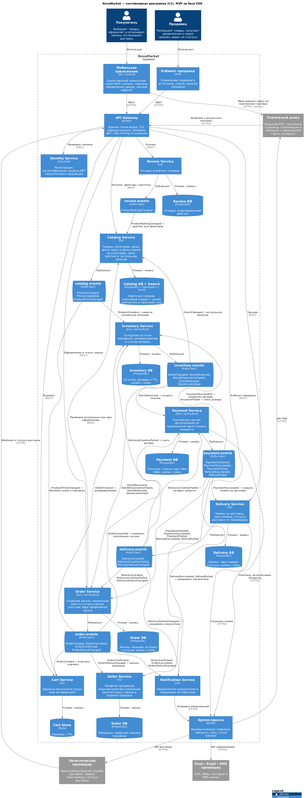
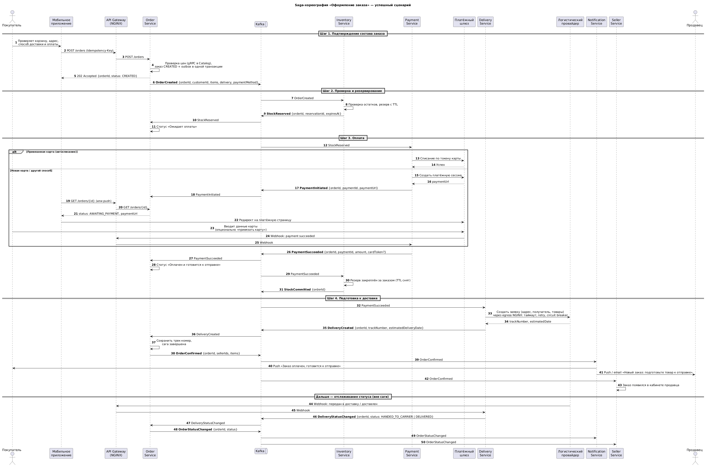
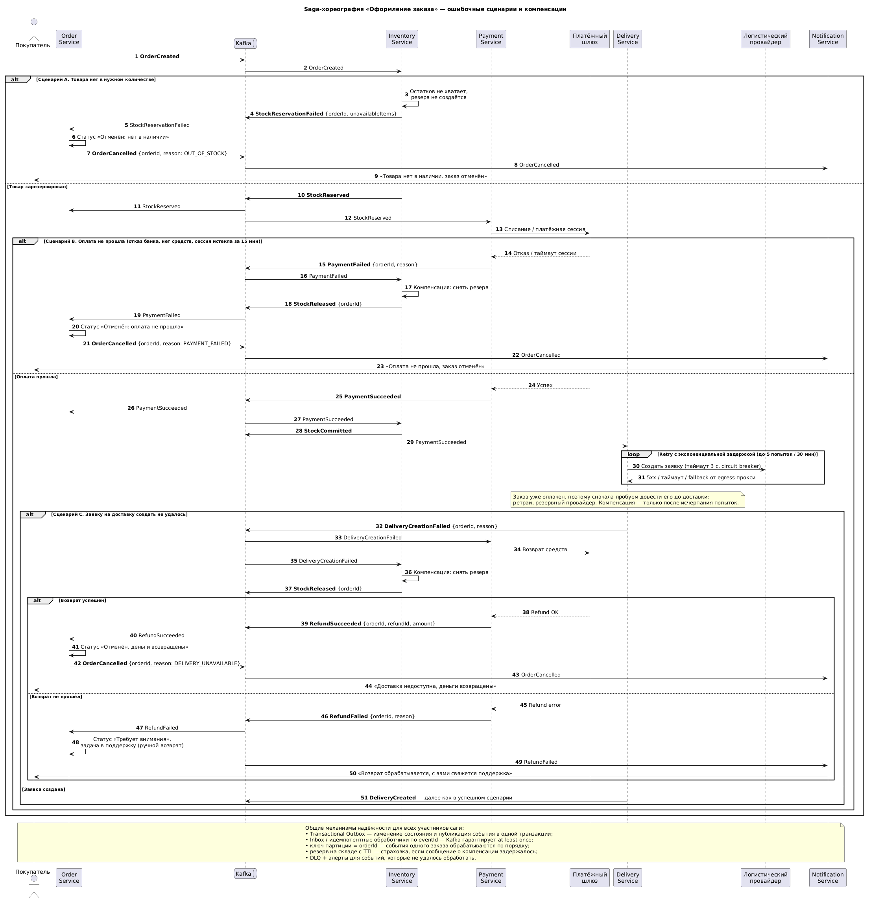

# Задание 1. Проектирование приложения на базе EDA

| Артефакт | Исходник (PlantUML) | Картинка |
|---|---|---|
| Контейнерная диаграмма C2 | [c2-containers.puml](c2-containers.puml) | [c2-containers.png](c2-containers.png) |
| Реестр событий Saga | этот файл, раздел [Реестр событий](#реестр-событий-saga-хореографии-оформления-заказа) | — |
| Sequence: успешный сценарий | [saga-success.puml](saga-success.puml) | [saga-success.png](saga-success.png) |
| Sequence: ошибочные сценарии и компенсации | [saga-failures.puml](saga-failures.puml) | [saga-failures.png](saga-failures.png) |

## Часть 1. Событийная архитектура

### Микросервисы

| Сервис | Назначение | Хранилище | Публикует | Подписан на |
|---|---|---|---|---|
| **API Gateway** (NGINX) | Единая точка входа для мобильного приложения и кабинета продавца: TLS, маршрутизация, проверка JWT, rate limiting по каналам, приём webhook'ов | — | — | — |
| **Egress-прокси** (NGINX) | Исходящие вызовы к внешним сервисам: таймауты, retry, circuit breaker | — | — | — |
| **Identity Service** | Регистрация и аутентификация покупателей и продавцов, JWT | Keycloak | — | — |
| **Catalog Service** | Каталог: товары, цены, фото, описание, категории; поиск и фильтрация по категории, цене, рейтингу; актуальное наличие | PostgreSQL, OpenSearch, Redis | `ProductCreated`, `ProductUpdated`, `ProductPriceChanged` | `StockChanged`, `ProductRatingChanged` |
| **Review Service** | Отзывы покупателей и рейтинг товара | PostgreSQL | `ProductRatingChanged` | — |
| **Cart Service** | Корзина (товар добавлен, заказ ещё не оформлен) | Redis | — | `ProductPriceChanged`, `OrderCreated` |
| **Order Service** | Оформление заказа, жизненный цикл и статусы заказа, личный кабинет покупателя | PostgreSQL | `OrderCreated`, `OrderConfirmed`, `OrderCancelled`, `OrderStatusChanged` | `StockReserved`, `StockReservationFailed`, `StockReleased`, `StockCommitted`, `PaymentInitiated`, `PaymentSucceeded`, `PaymentFailed`, `RefundSucceeded`, `RefundFailed`, `DeliveryCreated`, `DeliveryCreationFailed`, `DeliveryStatusChanged` |
| **Inventory Service** | Остатки продавцов на складе, резервирование, снятие резерва | PostgreSQL | `StockChanged`, `StockReserved`, `StockReservationFailed`, `StockReleased`, `StockCommitted` | `ProductCreated`, `OrderCreated`, `PaymentSucceeded`, `PaymentFailed`, `DeliveryCreationFailed` |
| **Payment Service** | Платёжные сессии, автосписание по привязанной карте (токен PSP, без хранения PAN), возвраты | PostgreSQL | `PaymentInitiated`, `PaymentSucceeded`, `PaymentFailed`, `RefundSucceeded`, `RefundFailed` | `StockReserved`, `OrderCancelled`, `DeliveryCreationFailed` |
| **Delivery Service** | Заявки на доставку в логистическую службу, трек-номера, статусы доставки | PostgreSQL | `DeliveryCreated`, `DeliveryCreationFailed`, `DeliveryStatusChanged` | `PaymentSucceeded` |
| **Seller Service** | Профили продавцов (новый продавец — это данные, а не изменение архитектуры), заказы в разрезе продавца для кабинета | PostgreSQL | — | `OrderConfirmed`, `OrderStatusChanged` |
| **Notification Service** | Push, email и SMS покупателям и продавцам | — | — | `OrderConfirmed`, `OrderCancelled`, `OrderStatusChanged`, `DeliveryStatusChanged`, `RefundSucceeded`, `RefundFailed` |

### Почему так

- **Брокер — Apache Kafka, по топику на домен** (`order.events`, `payment.events`, ...). Многие события нужны сразу нескольким потребителям: `PaymentSucceeded` слушают Order, Inventory и Delivery, а `OrderCreated` — Inventory и Cart. Поэтому на схеме потоки показаны через топики брокера (первый вариант): продюсер публикует в топик, на каждой стрелке от топика к потребителю подписано, какое событие он берёт и зачем. Новый сервис по подписке (рекомендации, аналитика, антифрод) подключается новой consumer group, и продюсеров менять не нужно.
- **Ключ партиции — `orderId`**, поэтому события одного заказа обрабатываются по порядку.
- **Актуальность цены и наличия.** Inventory публикует `StockChanged`, а Catalog обновляет поисковый индекс. Так покупатель видит актуальное наличие, но не нагружает склад синхронными запросами. При оформлении Order Service ещё раз сверяет цены с Catalog синхронно, по gRPC.
- **Быстрый отклик.** Оформление заказа асинхронное: `POST /orders` сразу возвращает `202 Accepted` с `orderId`, а дальше статус приходит push-уведомлением или запросом `GET /orders/{id}`. Каталог читается из OpenSearch и кэша Redis.
- **Надёжность доставки событий.** Transactional Outbox у продюсеров, идемпотентные обработчики (inbox по `eventId`) у потребителей, DLQ для «ядовитых» сообщений.

## Часть 2. Saga-хореография «Оформление заказа»

Координатора нет: каждый сервис реагирует на события соседей и сам публикует результат своего шага. Компенсации тоже запускаются событиями.

Статусы заказа для покупателя: «Ожидает оплаты» → «Оплачен и готовится к отправке» → «Передан в доставку» → «Доставлен», а также «Отменён» с причиной.

### Реестр событий Saga-хореографии оформления заказа

| № | Этап | Тип события | Название | Продюсер | Потребители |
|---|---|---|---|---|---|
| 1 | Заказ оформлен покупателем (шаг 1) | domain | `OrderCreated` | Order | Inventory, Cart |
| 2 | Товары зарезервированы на складе (шаг 2) | domain | `StockReserved` | Inventory | Order, Payment |
| 3 | Ошибка резервирования: товара нет в нужном количестве | failure | `StockReservationFailed` | Inventory | Order |
| 4 | Создана платёжная сессия, покупатель перенаправляется на платёжную страницу (шаг 3) | domain | `PaymentInitiated` | Payment | Order |
| 5 | Успешная оплата (новой или привязанной картой) | domain | `PaymentSucceeded` | Payment | Order, Inventory, Delivery |
| 6 | Ошибка оплаты: отказ банка, нехватка средств, истёк срок платёжной сессии | failure | `PaymentFailed` | Payment | Order, Inventory |
| 7 | Резерв закреплён за оплаченным заказом | domain | `StockCommitted` | Inventory | Order |
| 8 | Заявка на доставку создана, получен трек-номер (шаг 4) | domain | `DeliveryCreated` | Delivery | Order |
| 9 | Ошибка создания заявки на доставку (после ретраев и резервного провайдера) | failure | `DeliveryCreationFailed` | Delivery | Payment, Inventory, Order |
| 10 | Заказ подтверждён: оплачен, зарезервирован, передан в логистику; продавцу уходит уведомление | domain | `OrderConfirmed` | Order | Notification, Seller |
| 11 | Снятие резерва товара | compensation | `StockReleased` | Inventory | Order |
| 12 | Возврат средств покупателю | compensation | `RefundSucceeded` | Payment | Order, Notification |
| 13 | Ошибка возврата средств (уходит в ручную обработку поддержкой) | failure | `RefundFailed` | Payment | Order, Notification |
| 14 | Отмена заказа | compensation | `OrderCancelled` | Order | Notification, Payment, Seller |

Ключевые поля всех событий: `eventId`, `eventType`, `occurredAt`, `orderId` (ключ партиции), `correlationId`. Payload зависит от события: позиции заказа, сумма, причина ошибки, трек-номер и т.д.

### Сценарии и компенсации

| Сценарий | Где сломалось | Компенсации |
|---|---|---|
| Успех | — | — |
| A. Нет товара | Inventory → `StockReservationFailed` | `OrderCancelled` (резерва и платежа ещё нет) |
| B. Оплата не прошла | Payment → `PaymentFailed` | `StockReleased` → `OrderCancelled` |
| C. Не удалось создать заявку на доставку | Delivery → `DeliveryCreationFailed` | `RefundSucceeded` + `StockReleased` → `OrderCancelled` |
| C'. Возврат не прошёл | Payment → `RefundFailed` | Заказ переходит в «Требует внимания», ручной возврат через поддержку |

Если покупатель уже оплатил заказ, бизнес требует довести его до доставки. Поэтому Delivery Service сначала ретраит создание заявки с экспоненциальной задержкой и пробует резервного провайдера. Внешний вызов защищён таймаутом и circuit breaker в egress-прокси (см. Task4). Компенсация с возвратом денег запускается только после исчерпания попыток.

### Успешный сценарий

### Ошибочные сценарии

