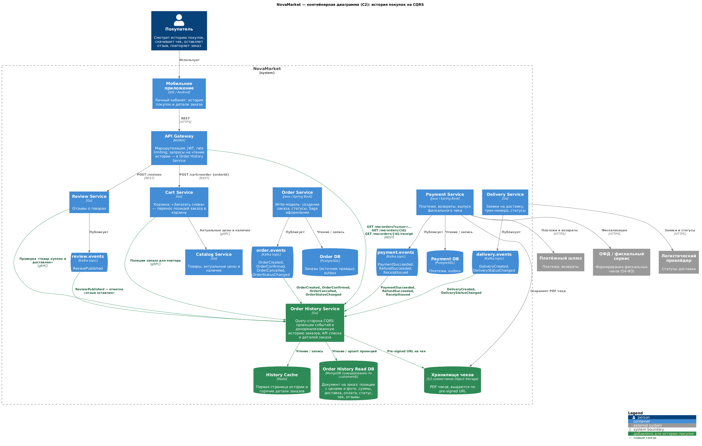

# Задание 2. Агрегированные данные на фронтенде: история покупок

| Артефакт | Файл |
|---|---|
| Контейнерная диаграмма C2 с обновлённой архитектурой | [c2-order-history.puml](c2-order-history.puml) → [c2-order-history.png](c2-order-history.png) |
| ADR | [ADR.md](ADR.md) |

Выбранное решение: **CQRS**. Новый Order History Service строит денормализованную read-модель истории заказов (MongoDB + кэш Redis) из доменных событий Kafka, которые уже публикуют Order, Payment, Delivery и Review. Полный Event Sourcing не используется. Альтернативы (API Composition, Event Sourcing) и последствия описаны в [ADR](ADR.md).

На диаграмме новые контейнеры и связи выделены зелёным.

