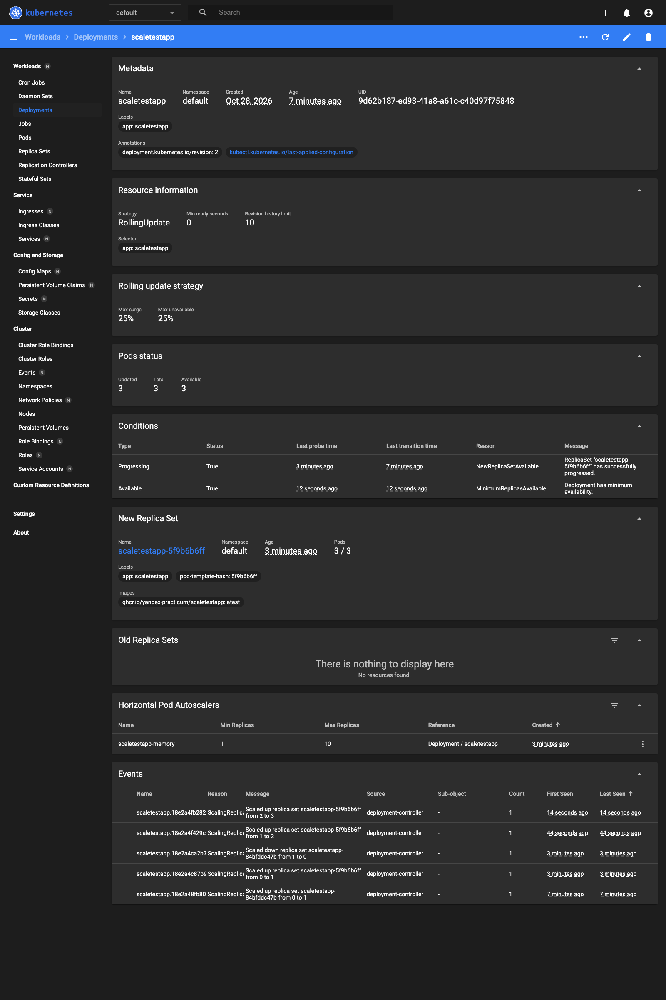
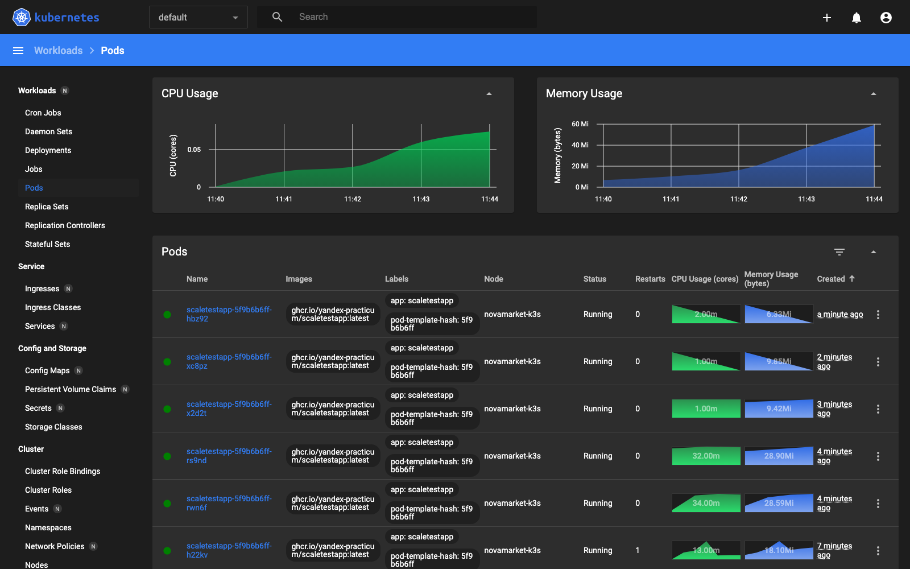
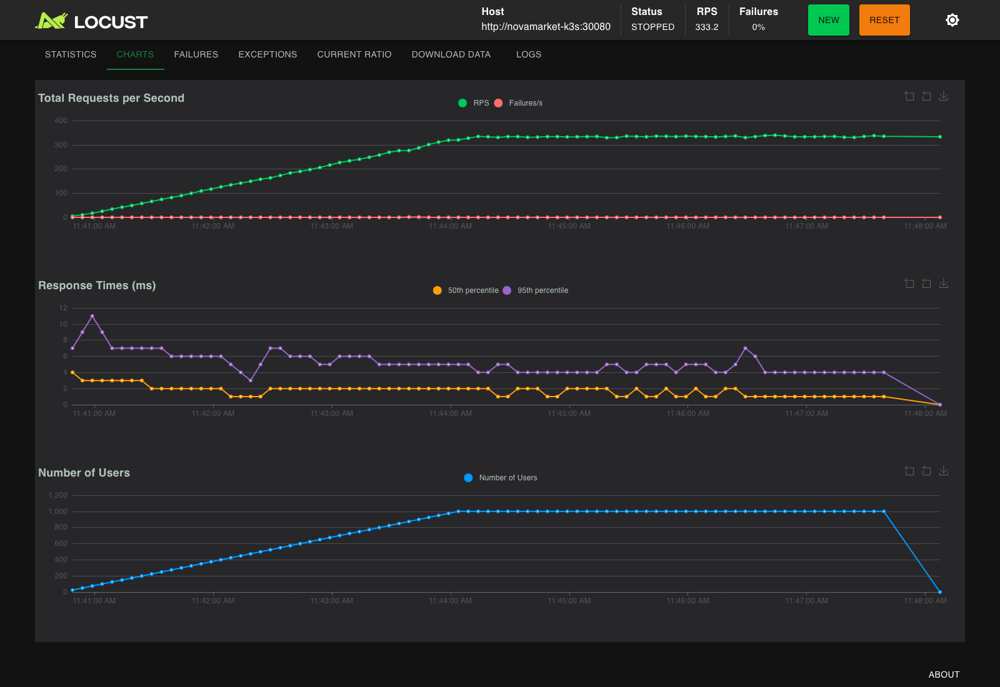
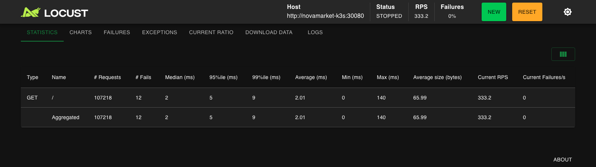
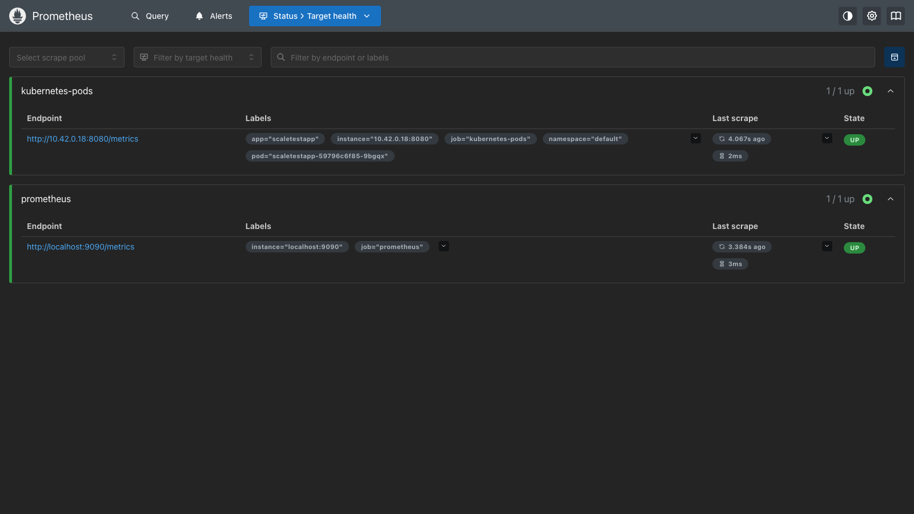
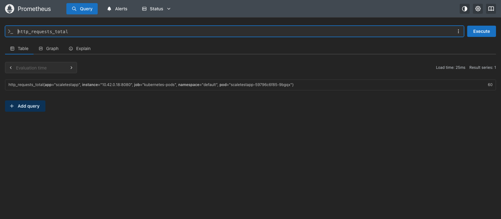
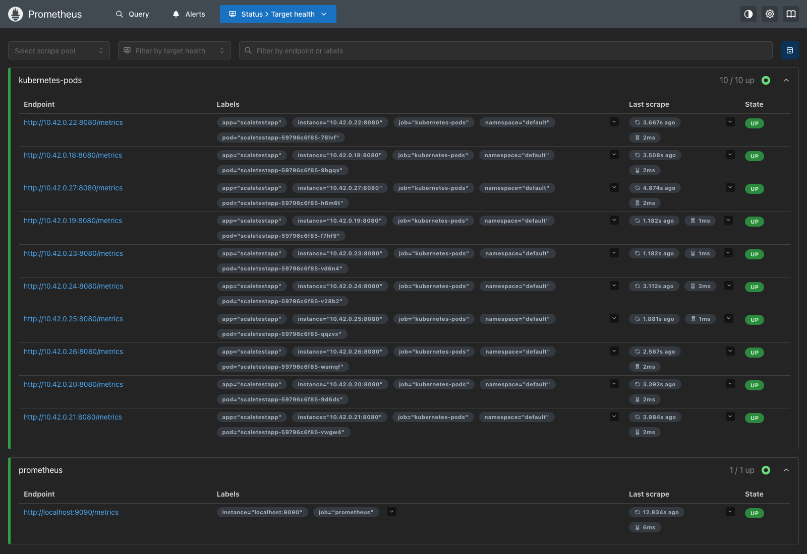
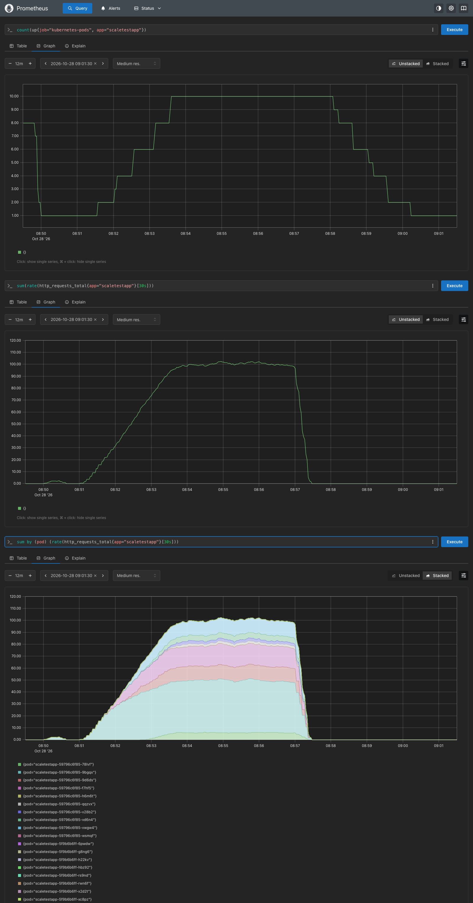
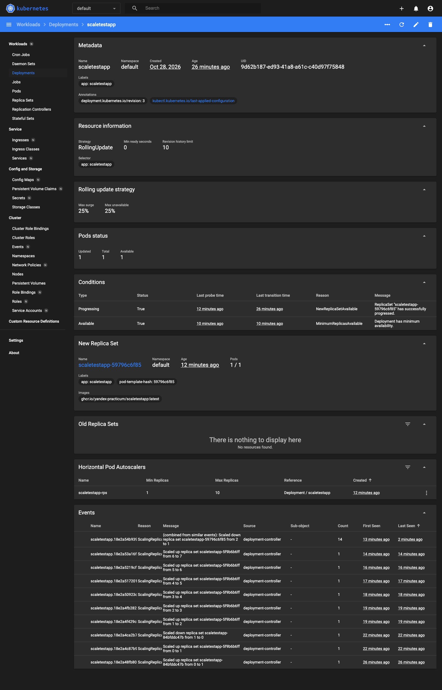
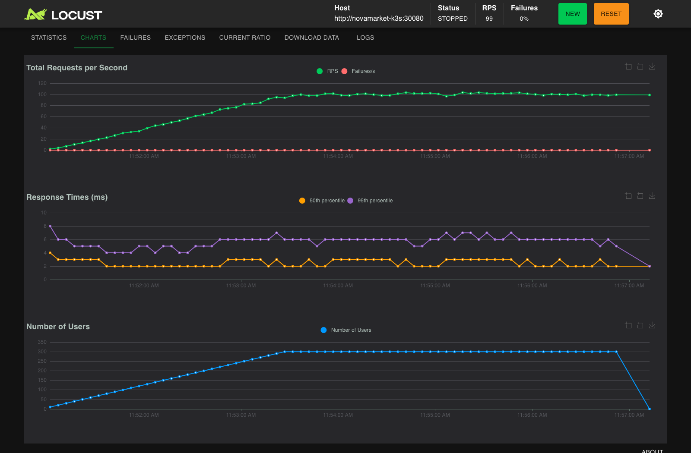

# Задание 3. Масштабирование приложения под нагрузку

## Файлы

| Файл | Что это |
|---|---|
| [deployment.yaml](deployment.yaml) | Deployment `scaletestapp`: 1 реплика, `limits.memory: 30Mi`, аннотации для Prometheus |
| [service.yaml](service.yaml) | Service для доступа к приложению (NodePort 30080) |
| [hpa-memory.yaml](hpa-memory.yaml) | Часть 1. HPA по утилизации памяти: цель 80%, 1..10 реплик |
| [prometheus/prometheus.yaml](prometheus/prometheus.yaml) | Часть 2. Prometheus: RBAC, конфиг сбора метрик подов по аннотациям, Deployment, Service |
| [prometheus/prometheus-adapter.yaml](prometheus/prometheus-adapter.yaml) | Часть 2. prometheus-adapter: правило `http_requests_total` → `http_requests_per_second`, APIService `custom.metrics.k8s.io` |
| [hpa-rps.yaml](hpa-rps.yaml) | Часть 2. Новая версия HPA: по RPS на под, цель 10 RPS, 1..10 реплик |
| [locustfile.py](locustfile.py) | Сценарий нагрузки из задания |
| [results/part1-memory-hpa/](results/part1-memory-hpa) | Скриншоты и логи части 1 |
| [results/part2-rps-hpa/](results/part2-rps-hpa) | Скриншоты и логи части 2 |

## Окружение

Вместо Minikube использовался **k3s v1.33 в Docker-контейнере** (тот же подход, что у k3d): одноузловой Kubernetes без установки дополнительных пакетов на машину. Манифесты от этого не зависят и применяются в Minikube без изменений.

- **metrics-server** в k3s встроен и включён по умолчанию; в Minikube это `minikube addons enable metrics-server`.
- **Kubernetes Dashboard** v2.7.0 развёрнут из официального манифеста; в Minikube то же самое даёт `minikube dashboard`.
- **Образ приложения.** `ghcr.io/yandex-practicum/scaletestapp:latest` опубликован только для `linux/amd64`, а тест шёл на Apple Silicon (arm64). Поэтому образ собран локально из [официального исходника](https://github.com/Yandex-Practicum/scaletestapp) под тем же тегом и импортирован в кластер. Отсюда `imagePullPolicy: IfNotPresent` в Deployment. На amd64 образ просто скачивается из ghcr.io.
- Locust 2.47 запускался в контейнере `locustio/locust`, нагрузка шла на NodePort сервиса. Так kube-proxy распределяет соединения по всем репликам; `kubectl port-forward` привязывается к одному поду и для теста масштабирования не подходит.

### Как воспроизвести в Minikube

```bash
minikube start
minikube addons enable metrics-server

# Часть 1
kubectl apply -f deployment.yaml -f service.yaml -f hpa-memory.yaml
minikube service scaletestapp --url            # адрес для Locust
locust -f locustfile.py --host=<адрес из предыдущей команды>
kubectl get hpa -w                             # или minikube dashboard

# Часть 2
kubectl delete -f hpa-memory.yaml
kubectl apply -f prometheus/prometheus.yaml -f prometheus/prometheus-adapter.yaml
kubectl get --raw "/apis/custom.metrics.k8s.io/v1beta1/namespaces/default/pods/*/http_requests_per_second"
kubectl apply -f hpa-rps.yaml
minikube service -n monitoring prometheus --url   # Prometheus Web UI
locust -f locustfile.py --host=<адрес scaletestapp>
```

## Часть 1. HPA по утилизации памяти

```yaml
resources:
  requests: { cpu: 50m, memory: 20Mi }
  limits:   { memory: 30Mi }
---
metrics:
  - type: Resource
    resource: { name: memory, target: { type: Utilization, averageUtilization: 80 } }
```

HPA считает утилизацию относительно `requests`, а не `limits`, поэтому `requests.memory` обязателен. Он подобран по замеру: в простое под потребляет ~4–6 Mi, под нагрузкой 600 пользователей — до 23 Mi. При `requests = 20Mi` цель 80% соответствует ~16 Mi на под, а лимит 30Mi оставлен по заданию.

**Нагрузка:** Locust, 1000 пользователей (по 5 новых в секунду), сценарий из задания, ~330 RPS, 0% ошибок, p95 ≤ 11 мс.

**Результат:** HPA увеличил число реплик с 1 до 8 ([kubectl-events.log](results/part1-memory-hpa/kubectl-events.log)):

| Время (UTC) | Реплик | Причина |
|---|---|---|
| 08:42:50 | 1 → 2 | memory resource utilization (percentage of request) above target (104–128% / 80%) |
| 08:43:20 | 2 → 3 | то же |
| 08:44:20 | 3 → 4 | то же |
| 08:45:20 | 4 → 5 | то же |
| 08:46:05 | 5 → 6 | то же |
| 08:47:50 | 6 → 7 | то же |
| 08:49:05 | 7 → 8 | то же |

Пока реплик не хватало, первый под упёрся в лимит 30Mi и был перезапущен с причиной **OOMKilled** ([kubectl-pods-final.log](results/part1-memory-hpa/kubectl-pods-final.log)). Это ровно та проблема, которую описывает задание; дальше HPA добавил реплики, и рестарты прекратились.

**Вывод.** После снятия нагрузки Go-приложение не сразу возвращает память ОС, поэтому утилизация памяти остаётся выше 80% и HPA не уменьшает число реплик (8 реплик держались и после остановки Locust). Память — запаздывающий и «липкий» сигнал для такого сервиса. Поэтому в части 2 масштабирование переведено на RPS.

| Скриншот | Что видно |
|---|---|
|  | Dashboard, Deployment: события `Scaled up ... from 1 to 2`, `from 2 to 3` |
|  | Dashboard, Pods под нагрузкой: память подов 18–29 Mi, у первого пода Restarts = 1 (OOMKilled) |
|  | Dashboard, Deployment: 8/8 подов, полная цепочка событий масштабирования 1 → 8 |
|  | Locust: рост пользователей до 1000 и RPS до ~330 |
|  | Locust: итоговая статистика |

Логи: [kubectl get hpa -w](results/part1-memory-hpa/kubectl-get-hpa-watch.log), [kubectl get pods -w](results/part1-memory-hpa/kubectl-get-pods-watch.log), [мониторинг hpa/deploy/top каждые 15 с](results/part1-memory-hpa/hpa-memory-monitor.log), [kubectl describe hpa](results/part1-memory-hpa/kubectl-describe-hpa-memory.log), [события](results/part1-memory-hpa/kubectl-events.log).

## Часть 2. HPA по RPS (Prometheus + prometheus-adapter)

Как устроено:

1. **Экспорт метрик.** Поды приложения помечены аннотациями `prometheus.io/scrape: "true"`, `prometheus.io/port: "8080"`, `prometheus.io/path: /metrics`. Prometheus находит их через `kubernetes_sd_configs` (role: pod), опрашивает каждые 5 с и проставляет метки `namespace` и `pod`.
2. **prometheus-adapter** превращает счётчик в RPS и публикует его в Kubernetes API `custom.metrics.k8s.io`:
   ```yaml
   - seriesQuery: 'http_requests_total{namespace!="",pod!=""}'
     resources: { overrides: { namespace: {resource: namespace}, pod: {resource: pod} } }
     name: { matches: "^(.*)_total$", as: "${1}_per_second" }
     metricsQuery: 'sum(rate(<<.Series>>{<<.LabelMatchers>>}[30s])) by (<<.GroupBy>>)'
   ```
3. **HPA** ([hpa-rps.yaml](hpa-rps.yaml)) использует метрику типа `Pods`: `http_requests_per_second`, `AverageValue: 10`, то есть 10 RPS на под.

**Проверка, что метрики доходят:** Prometheus → Status → Target health: под `scaletestapp` в состоянии UP. В Query `http_requests_total` возвращает значение с метками `pod`, `namespace`. Custom Metrics API отдаёт значение для каждого пода ([custom-metrics-api.log](results/part2-rps-hpa/custom-metrics-api.log)).

**Нагрузка:** Locust, 300 пользователей (по 2 новых в секунду), 6 минут; на пике ~100 RPS, в среднем за тест ~80 RPS, 0% ошибок.

**Результат:** реплики масштабировались вверх под нагрузкой и вниз после её снятия ([kubectl-events.log](results/part2-rps-hpa/kubectl-events.log)):

| Время (UTC) | Реплик | Причина |
|---|---|---|
| 08:51:28 | 1 → 2 | pods metric http_requests_per_second above target |
| 08:51:58 | 2 → 4 | то же |
| 08:52:28 | 4 → 6 | то же |
| 08:52:59 | 6 → 8 | то же |
| 08:53:29 | 8 → 10 | то же, далее ~10 RPS на под при 10 репликах |
| 08:58:00 | 10 → 8 | All metrics below target (нагрузка снята в 08:56:57) |
| 08:58:30 | 8 → 6 | то же |
| 08:59:00 | 6 → 4 | то же |
| 08:59:30 | 4 → 2 | то же |
| 09:00:01 | 2 → 1 | то же |

| Скриншот | Что видно |
|---|---|
|  | Prometheus, Target health: под приложения обнаружен и в состоянии UP |
|  | Prometheus, Query: метрика `http_requests_total` с метками `pod`, `namespace` |
|  | Prometheus, Target health под нагрузкой: 10 подов приложения |
|  | Prometheus, Graph за время теста: число реплик 1 → 10 → 1 (`count(up{...})`), суммарный RPS до ~100 и RPS по подам (stacked). Слева на графике реплик — хвост части 1 (8 реплик удаляются при переключении на HPA по RPS) |
|  | Dashboard, Deployment: события масштабирования по RPS вверх и вниз |
|  | Locust: пользователи и RPS |

Логи: [kubectl get hpa -w](results/part2-rps-hpa/kubectl-get-hpa-watch.log), [kubectl get pods -w](results/part2-rps-hpa/kubectl-get-pods-watch.log), [мониторинг HPA + RPS по подам из Custom Metrics API](results/part2-rps-hpa/hpa-rps-monitor.log), [kubectl describe hpa](results/part2-rps-hpa/kubectl-describe-hpa-rps.log).

## Почему так настроен `behavior`

Оба HPA:

- `scaleUp`: без окна стабилизации, до +4 подов за 15 с. На пике важно быстро добавить реплики, иначе поды падают по OOM.
- `scaleDown`: окно стабилизации 60 с, не больше 2 подов за 30 с. Так реплики не «дребезжат» при колебаниях нагрузки.

Для продакшена окно scale-down стоит увеличить (стандартные 300 с), а `minReplicas` выставить не ниже 2–3 ради отказоустойчивости.
