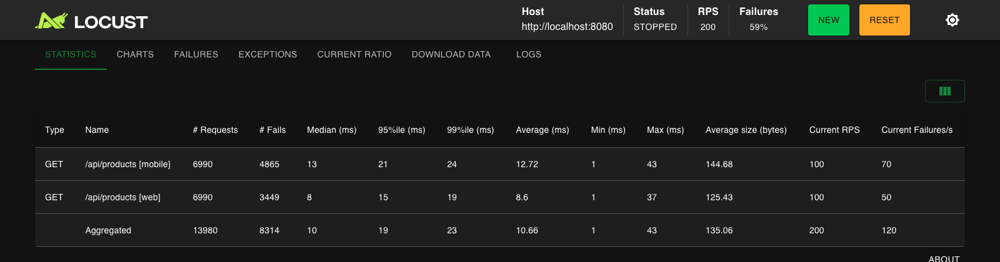
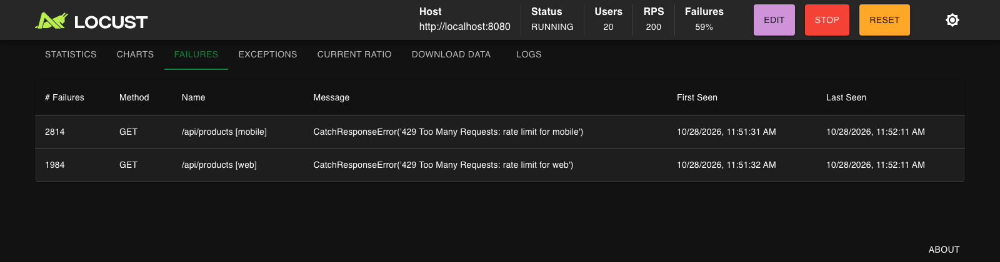
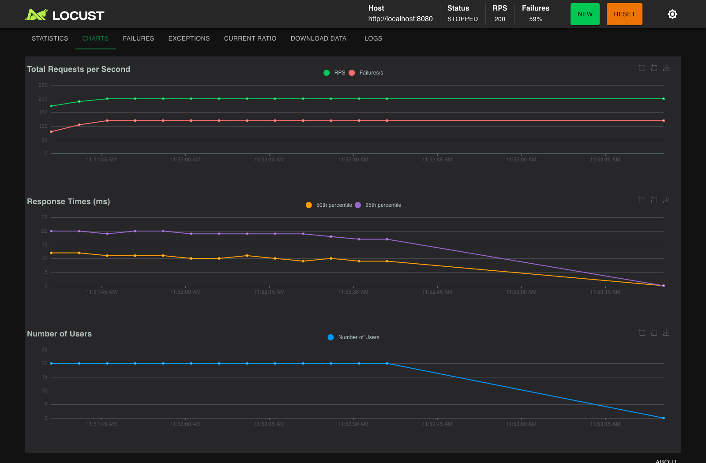
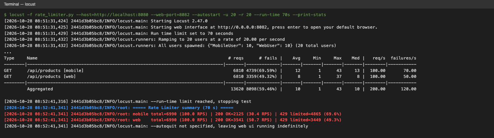
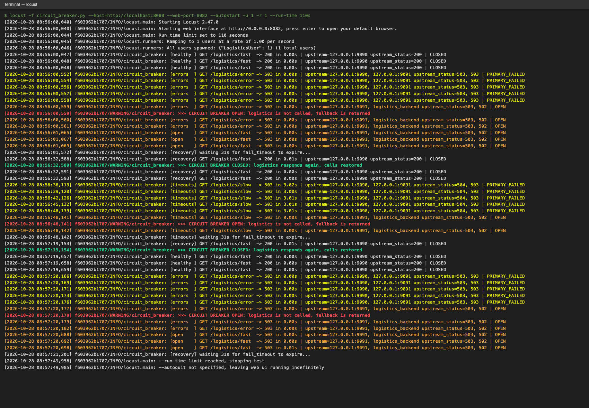
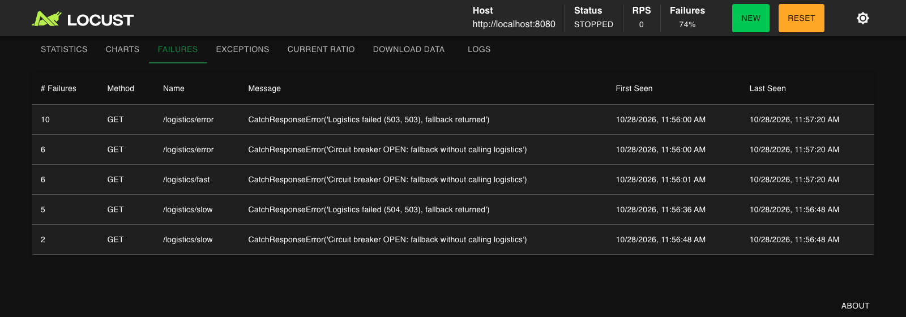
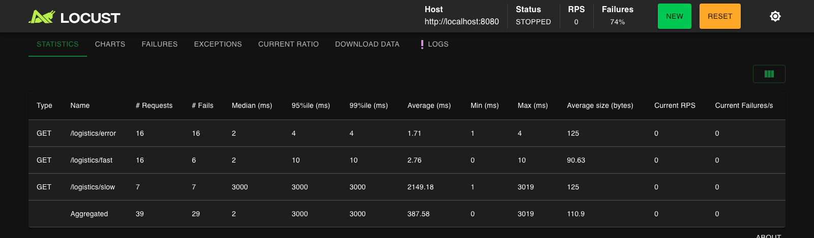

# Задание 4. Повышение надёжности: Rate Limiter и Circuit Breaker в NGINX

| Файл | Что это |
|---|---|
| [nginx-rate-limiter.conf](nginx-rate-limiter.conf) | Часть 1. API Gateway: раздельные лимиты для веба и мобильного приложения + тестовый бэкенд на `:8081` |
| [nginx-circuit-breaker.conf](nginx-circuit-breaker.conf) | Часть 2. Прокси к логистике: таймаут 3 с, circuit breaker 5 ошибок / 30 с, fallback + тестовый логистический сервис на `:9090` |
| [njs/logistics_mock.js](njs/logistics_mock.js) | Задержка 5 с для тестового `/slow` (через njs; `return` в NGINX отвечает мгновенно и таймаут не проверить) |
| [rate_limiter.py](rate_limiter.py) | Часть 3. Locust-сценарий для Rate Limiter |
| [circuit_breaker.py](circuit_breaker.py) | Часть 3. Locust-сценарий для Circuit Breaker |
| [screenshots/](screenshots) | Скриншоты срабатывания |
| [logs/](logs) | Логи Locust и NGINX |

## Часть 1. Rate Limiter

**Что было не так:** одна зона `one` на 100 r/s и `burst=200` без `nodelay` для всех клиентов сразу. Веб и мобильные клиенты получали одинаковый лимит. Кроме того, при перегрузке запросы не отбрасывались, а вставали в очередь до 200 штук, и задержка ответа росла до 2 с.

**Что сделано:**

```nginx
map $http_client_type $web_limit_key     { default ""; web    $binary_remote_addr; }
map $http_client_type $mobile_limit_key  { default ""; mobile $binary_remote_addr; }
map $http_client_type $default_limit_key { default $binary_remote_addr; web ""; mobile ""; }

limit_req_zone $web_limit_key     zone=web_limit:10m     rate=50r/s;
limit_req_zone $mobile_limit_key  zone=mobile_limit:10m  rate=30r/s;
limit_req_zone $default_limit_key zone=default_limit:10m rate=30r/s;
limit_req_status 429;

location /api/ {
    limit_req zone=web_limit     burst=50 nodelay;
    limit_req zone=mobile_limit  burst=30 nodelay;
    limit_req zone=default_limit burst=30 nodelay;
    proxy_pass http://backend;
}
```

- Канал определяется по заголовку `Client-Type` (`web` / `mobile`): по нему же различает клиентов тестовый бэкенд из задания.
- Для каждого канала своя зона с ключом `$binary_remote_addr`, то есть лимит считается с одного IP. Если запрос относится к другому каналу, ключ пустой, и NGINX не учитывает его в этой зоне.
- Клиенты без заголовка или с неизвестным типом получают самый строгий лимит, 30 r/s. Иначе лимит можно было бы обойти, просто не передав заголовок.
- `burst` = секундный объём лимита с `nodelay`: короткие всплески проходят без задержки, а всё сверх лимита сразу получает `429 Too Many Requests` (вместо `503` по умолчанию).

В продакшене тип клиента лучше брать не из заголовка, который может подделать сам клиент, а из проверенного API-ключа или claim в JWT, через тот же `map`.

**Тест:** `locust -f rate_limiter.py --host=http://localhost:8080 --web-port=8082`, 20 пользователей (10 web + 10 mobile) с одного IP, каждый ~10 RPS, то есть ~100 RPS на канал.

| Канал | Отправлено | 200 OK | 429 | Пропущено |
|---|---|---|---|---|
| web | 6990 (100 RPS) | 3541 | 3449 (49%) | **50.7 RPS** (лимит 50) |
| mobile | 6990 (100 RPS) | 2125 | 4865 (70%) | **30.4 RPS** (лимит 30) |

Небольшое превышение лимита — это `burst`, который выбирается один раз в начале теста.

| Скриншот | Что видно |
|---|---|
|  | Статистика Locust: при 100 RPS на канал ошибок у web 50/с, у mobile 70/с, то есть пропускается 50 и 30 RPS |
|  | Вкладка Failures: `429 Too Many Requests` отдельно для web и mobile |
|  | Графики RPS и Failures/s |
|  | Лог Locust: итоговая сводка по каналам |

Логи: [Locust](logs/locust-rate-limiter.log), [NGINX access (фрагмент, видно `limit_req=PASSED/REJECTED`)](logs/nginx-rate-limiter-access.sample.log), [NGINX error (фрагмент, `limiting requests ... by zone "mobile_limit"`)](logs/nginx-rate-limiter-error.sample.log).

## Часть 2. Circuit Breaker

**Что было не так:** таймауты по 30 с. Пока логистика «висит», запрос пользователя ждёт полминуты. Fallback'а нет, и проблемный сервис продолжает получать запросы.

**Что сделано:**

```nginx
upstream logistics_backend {
    zone logistics_backend 64k;                         # общее состояние для всех воркеров
    server 127.0.0.1:9090 max_fails=5 fail_timeout=30s; # 5 ошибок -> исключить на 30 с
    server 127.0.0.1:9091 backup max_fails=0;           # заглушка, без неё max_fails не работает
}

location /logistics/ {
    proxy_pass http://logistics_backend/;
    proxy_connect_timeout 3s;
    proxy_send_timeout 3s;
    proxy_read_timeout 3s;
    proxy_next_upstream error timeout http_500 http_502 http_503 http_504;
    proxy_next_upstream_tries 2;
    proxy_intercept_errors on;
    error_page 500 502 503 504 = @logistics_fallback;
}

location @logistics_fallback {
    add_header X-Fallback "logistics" always;
    add_header Retry-After 30 always;
    return 503 '{"status": "fallback", ...}';
}
```

Как это работает как circuit breaker:

| Состояние | Поведение NGINX |
|---|---|
| **Closed** | Запросы идут в логистику. Ошибка соединения, ответ дольше 3 с или 5xx считаются неуспешной попыткой (`proxy_next_upstream`), и клиент сразу получает fallback |
| **Open** | После 5 неуспешных попыток (`max_fails=5`) сервер исключается на 30 с (`fail_timeout=30s`). Все запросы, даже к рабочим эндпоинтам, мгновенно получают fallback, а логистика не вызывается |
| **Half-open** | Через 30 с NGINX пропускает к сервису пробный запрос. Если он успешен, счётчик сбрасывается и вызовы восстанавливаются; если нет — сервер снова исключается на 30 с |

Несколько неочевидных деталей:

- **Backup-сервер обязателен.** Если в upstream один сервер, NGINX игнорирует `max_fails`/`fail_timeout` и никогда не считает его недоступным. Это прямо сказано в документации `ngx_http_upstream_module`, и с одним `server` circuit breaker просто не размыкается. Backup — это локальная заглушка, которая получает трафик, только пока основной сервер исключён.
- **`zone`** хранит счётчики ошибок в разделяемой памяти. Без неё каждый worker-процесс считал бы свои 5 ошибок отдельно.
- **`127.0.0.1` вместо `localhost`.** `localhost` резолвится и в `127.0.0.1`, и в `::1`. Тогда в upstream было бы два адреса со своими счётчиками, и цепь размыкалась бы только после 10 ошибок.
- **Единый fallback через `error_page`.** Иначе в состоянии Open NGINX после ответа заглушки ищет следующий сервер и отдаёт `502 no live upstreams`. Сейчас любой итоговый 5xx превращается в один и тот же контролируемый ответ: `503` + JSON + `Retry-After: 30`.
- `max_fails` в open-source NGINX считает неуспешные попытки внутри окна `fail_timeout`. Подряд идущие ошибки в тесте укладываются в это окно, поэтому поведение совпадает с требованием «5 подряд». Строгий счётчик подряд идущих ошибок есть в NGINX Plus или в библиотеках вроде resilience4j на стороне сервиса.
- Тестовый `/slow` из задания отвечает мгновенно (`return 200`), поэтому таймаут на нём не проверить. Для теста задержка 5 с сделана через встроенный в официальный образ модуль njs ([njs/logistics_mock.js](njs/logistics_mock.js)). Остальной тестовый сервер взят из задания без изменений.

**Тест:** `locust -f circuit_breaker.py --host=http://localhost:8080 --web-port=8082`. Сценарий проходит фазы healthy → errors → open → recovery → timeouts. Состояние цепи определяется по заголовкам ответа NGINX (`X-Upstream-Addr`, `X-Fallback`) и пишется в лог Locust:

```
[healthy ] GET /logistics/fast  -> 200 in 0.00s | upstream=127.0.0.1:9090 upstream_status=200 | CLOSED
[errors  ] GET /logistics/error -> 503 in 0.00s | upstream=127.0.0.1:9090, 127.0.0.1:9091 upstream_status=503, 503 | PRIMARY_FAILED   x5
[errors  ] GET /logistics/error -> 503 in 0.00s | upstream=127.0.0.1:9091, logistics_backend upstream_status=503, 502 | OPEN
>>> CIRCUIT BREAKER OPEN: logistics is not called, fallback is returned
[open    ] GET /logistics/fast  -> 503 in 0.00s | upstream=127.0.0.1:9091, ... | OPEN          <- даже /fast не вызывается
[recovery] waiting 31s for fail_timeout to expire...
[recovery] GET /logistics/fast  -> 200 in 0.01s | upstream=127.0.0.1:9090 upstream_status=200 | CLOSED
>>> CIRCUIT BREAKER CLOSED: logistics responds again, calls restored
[timeouts] GET /logistics/slow  -> 503 in 3.02s | upstream=127.0.0.1:9090, 127.0.0.1:9091 upstream_status=504, 503 | PRIMARY_FAILED  x5
[timeouts] GET /logistics/slow  -> 503 in 0.00s | upstream=127.0.0.1:9091, ... | OPEN          <- больше не ждём 3 с
>>> CIRCUIT BREAKER OPEN: logistics is not called, fallback is returned
```

Что видно:

- Таймаут срабатывает ровно через 3 с вместо 30 с, а клиент получает fallback.
- После 5 ошибок или таймаутов цепь размыкается: ответ приходит за 0 мс, и логистика не вызывается вообще (в `upstream` нет `127.0.0.1:9090`).
- Через 30 с вызовы восстанавливаются.

`logistics_backend` в `$upstream_addr` означает, что NGINX попытался взять следующий сервер и не нашёл живых, после чего сработал `error_page`.

| Скриншот | Что видно |
|---|---|
|  | Лог Locust: переходы CLOSED → OPEN → CLOSED по ошибкам и по таймаутам, время ответа 3 с против 0 с |
|  | Locust Failures: `Logistics failed (503/504), fallback returned` — 5 ошибок, затем `Circuit breaker OPEN: fallback without calling logistics` |
|  | Статистика: `/logistics/slow` — медиана 3000 мс (таймаут), минимум 1 мс (цепь разомкнута) |

Логи: [Locust](logs/locust-circuit-breaker.log), [NGINX access/error](logs/nginx-circuit-breaker.log).

## Как запустить тесты

Достаточно Docker: официальный образ `nginx` уже содержит модуль njs, а Locust запускается из образа `locustio/locust`. Контейнер Locust подключается к сетевому namespace контейнера NGINX, поэтому команды совпадают с заданием (`--host=http://localhost:8080`).

```bash
cd Task4

# Rate Limiter
docker run -d --name nginx-rl -p 8080:8080 -p 8082:8082 \
  -v "$PWD/nginx-rate-limiter.conf:/etc/nginx/nginx.conf:ro" nginx:1.27-alpine
docker run --rm --network container:nginx-rl -v "$PWD:/mnt/locust" locustio/locust:2.47.0 \
  -f /mnt/locust/rate_limiter.py --host=http://localhost:8080 --web-port=8082
# UI: http://localhost:8082, 20 users, spawn rate 20
docker rm -f nginx-rl

# Circuit Breaker
docker run -d --name nginx-cb -p 8080:8080 -p 8082:8082 \
  -v "$PWD/nginx-circuit-breaker.conf:/etc/nginx/nginx.conf:ro" \
  -v "$PWD/njs:/etc/nginx/njs:ro" nginx:1.27-alpine
docker run --rm --network container:nginx-cb -v "$PWD:/mnt/locust" locustio/locust:2.47.0 \
  -f /mnt/locust/circuit_breaker.py --host=http://localhost:8080 --web-port=8082
# UI: http://localhost:8082, 1 user — сценарий последовательный
docker rm -f nginx-cb
```

Если NGINX и Locust установлены локально, подойдут команды из задания:
`locust -f rate_limiter.py --host=http://localhost:8080 --web-port=8082` и `locust -f circuit_breaker.py --host=http://localhost:8080 --web-port=8082`. Для circuit breaker путь `js_path` в конфиге нужно указать на каталог `njs/`.
